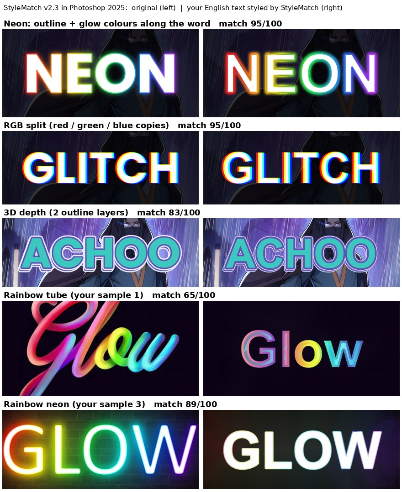

# StyleMatch

Photoshop script for manga / manhwa / webtoon typesetters (English and Arabic). It looks at the original text in the raw page, works out how it was made, and rebuilds that look on your translated text as **editable** layer styles, Smart Filters and masks.

## What it does
- **Matches the original look**: fill colour or gradient (also colours that change letter by letter), outlines (also gradient outlines), inner rims, soft inner shading, outer glows (also gradient glows and glows that change colour along the word), drop shadows, extra offset copies, RGB-split glitch, 3D depth, screentone dots, drawn details inside letters, grain, fade-outs, and art in front of the text (layer mask).
- **Sizes everything to your text** (outline/glow follow your letter weight).
- **Explains itself**: a hidden text layer "StyleMatch notes" lists every step, the Photoshop tool used and why, plus a **match score** (0-100) for how close the rebuild is to the original.
- **Looks library**: 22 ready looks (neon, 3D cartoon, glitch, comic, retro, chrome, gold, holographic, fire, ice, horror, grunge, ink, halftone, glitter...) built from scratch with Photoshop's own tools. No paid templates are used or included.
- One Ctrl+Z undoes a run.

## Requirements
Adobe Photoshop 2025 on Windows (tested). Photoshop 2022 or newer should work (UXP scripting); not tested.

## Install
1. Download the files in `dist/` (or the latest Release): `StyleMatch.psjs` and `StyleMatch Looks.jsx`.
2. Put both in the same folder, anywhere you like.
3. In Photoshop: **File > Scripts > Browse...** and pick the file. (Optional: copy them into Photoshop's `Presets/Scripts` folder to have them in the File > Scripts menu.)

## Use
### Match the original
1. Your page needs the original as a layer named **Raw** and the cleaned page as a layer named **Clean** (without those names: the lowest full-page layer is the raw, the next one up the clean).
2. Put your translated text roughly where the original text was.
3. Select your text layer(s) and run **StyleMatch.psjs**.
4. Tip: if your text sits far from the original, draw a marquee around the original text first.

### Apply a look
- Run **StyleMatch Looks.jsx**, pick a look, optionally set main colour, glow colour, depth and intensity, press **Apply**.
- Or type it in the layer name: `BOOM #preset cartoon3D color=#FF5533 depth=10 intensity=1.2`.
- Looks need no Raw/Clean layers.

### Settings
Open `StyleMatch.psjs` in a text editor; the `SETTINGS` block at the top explains each option (Radial Blur copy, fade masks, screentone, notes...). A text layer whose name contains `#radial` always gets a Radial Blur copy.

## Known limitations
- Bevel & Emboss is applied by looks, but not yet detected in raws (chrome / gold / glossy originals come out flat).
- Hand-made parts (cracks, drips, ink splatter, brush texture, warped letters) are not copied; the notes say how to make them.
- 3D depth is found on clean cases; heavily stylised pages may miss it.
- Thin colour fringes (1-2 px) are not separated from the letters.
- A wrong or missing Clean layer lowers accuracy (StyleMatch then estimates the background and says so in the notes).

## Build from source
`src/` holds the code (`fx_core.js` analysis, `fx_kb.js` / `fx_ref.js` knowledge, `fx_presets.js` looks, `sm_ps_main.js` Photoshop side). `python3 src/build_sm.py 2.4` writes `dist/StyleMatch.psjs`.

## Contributing
Want to improve it? See [CONTRIBUTING.md](CONTRIBUTING.md): new looks, better detection, test reports are all welcome.

## Feedback
Open an issue (Bug report / Feature request / Effect request). A screenshot of the original, your result, your Photoshop version and the text of the "StyleMatch notes" layer help most. Please do not upload whole chapters.

## Changelog
- **2.4**: Looks library (22 looks covering 72 popular text effects), `#preset` with colour/glow/depth/intensity options, Looks menu window, closest look named in the notes.
- **2.3**: colours along the word (letters, outlines, glow), soft inner shading, RGB split, extra offset copies, 3D depth as stacked drop shadows, Radial Blur copy, filter guide (32 filters), Radial Blur measured in Photoshop.
- **2.2**: gradient glows, glow + shadow pairs, art in front of the text, per-line colour ramps, match score.

## Support
StyleMatch is free and stays free. If it saves you time, you can support it with GitHub Sponsors (link coming soon).

## License
MIT, Copyright (c) 2026 Gamal Elwakedy.
